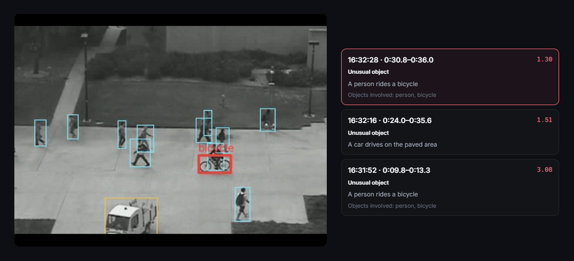

# Re-engineering an Interactive Tool for Detecting Suspicious Movement Using Intelligent Software Engineering

**Mustafa Mahmood, Naktal Edan**
Department of Software, College of Computer Science and Mathematics, University of Mosul, Mosul, Iraq

*SMD Intelligence: an intelligent video analytics platform for suspicious movement detection.*

*SMD Intelligence monitoring a test video. Each unusual object raises its own alert, with its time span and a
short explanation: two cyclists and a truck on a pedestrian walkway.*

> **Code will be available soon.** The source code, configurations and documentation will be released in this
> repository after the accompanying paper has been accepted for publication.

## Citation

The citation will be added here once the paper is published.

## Contact

Mustafa Mahmood: mustafa.24csp10@student.uomosul.edu.iq
